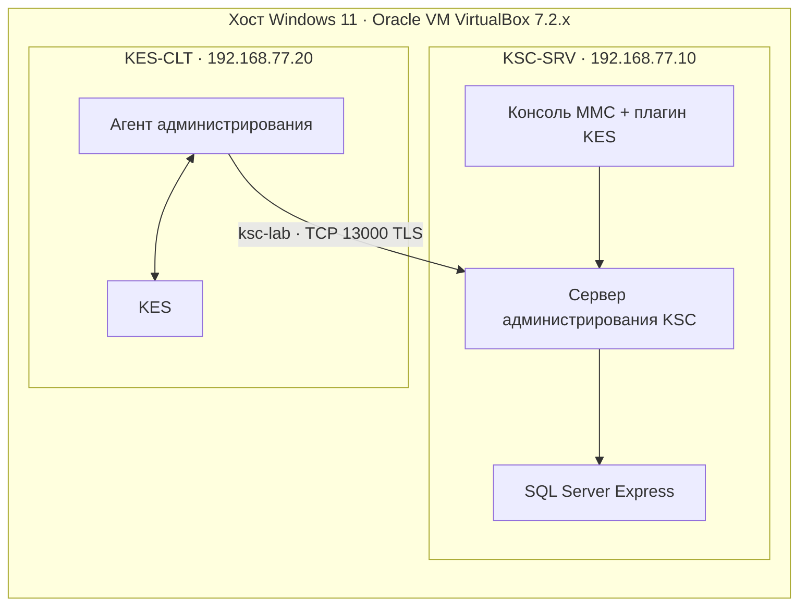

# Схема и совместимость

Ниже схема повторной сборки. Связь между Сервером администрирования и Агентом подтверждена, KES установлен удалённо. В прежней практике Windows 11 была хостом VirtualBox, а Windows 10 — управляемой ВМ. Точное размещение прежнего Сервера администрирования и версии компонентов не подтверждены.

Сервер KSC хранит настройки и события. Консоль MMC — интерфейс администратора. Плагин добавляет в неё настройки конкретной версии KES. Агент на рабочей станции связывается с сервером, получает задания и политики и передаёт события. KES применяет настройки на самой станции. SQL Server хранит данные KSC.

## Компоненты повторной сборки

| Роль | Планируемая версия | Основание |
| --- | --- | --- |
| Хост | Windows 11 Home x64, обнаружена сборка 26300 | Локальная проверка. Совместимость конкретной сборки с драйверами VirtualBox проверяется установкой |
| Гипервизор | Oracle VM VirtualBox 7.2.22 r175245 установлен | KSC 15.1 включает VirtualBox 7.x в списке платформ для Сервера администрирования. [Требования KSC](https://support.kaspersky.com/ksc/15.1/255791), [руководство Oracle](https://docs.oracle.com/en/virtualization/virtualbox/7.2/user/installation.html) |
| KSC-SRV | Windows Server 2022 Standard Evaluation x64, Desktop Experience, сборка 20348 | ОС установлена. Входит в список поддерживаемых. [Требования KSC](https://support.kaspersky.com/ksc/15.1/255791), [Microsoft Evaluation Center](https://www.microsoft.com/en-us/evalcenter/evaluate-windows-server-2022) |
| СУБД на KSC-SRV | Microsoft SQL Server 2022 Express x64, экземпляр SQLEXPRESS, 16.0.1000.6 | Служба работает, ответ на локальный запрос подтверждён. [Требования KSC](https://support.kaspersky.com/ksc/15.1/255791), [требования Microsoft](https://learn.microsoft.com/en-us/sql/sql-server/install/hardware-and-software-requirements-for-installing-sql-server-2022) |
| Сервер и консоль | KSC Windows 15.1 Update 3, сервер 15.1.0.28509 и MMC | Установлены. Сервер запущен и слушает TCP 13000. Сборка содержит исправление CVE-2026-88941. [Бюллетень Kaspersky](https://support.kaspersky.com/16351) |
| KES-CLT | Windows 10 Enterprise Evaluation 22H2 x64, сборка 19045.2006 | Установлена и проверена в виртуальной машине. Windows 10 22H2 завершила обычную поддержку 14.10.2025. [Жизненный цикл Microsoft](https://learn.microsoft.com/en-us/lifecycle/announcements/windows-10-end-of-support) |
| Агент на KES-CLT | Network Agent для Windows x64 17.0.0.3992 | Установлен и синхронизируется с сервером по TLS. [Бюллетень Kaspersky](https://support.kaspersky.com/16351), [требования к ОС агента](https://support.kaspersky.com/ksc/15.1/255797) |
| Защита KES-CLT | KES для Windows 12.12.0.522, стандартный режим, плагин MMC 12.12 | Установлена удалённо через Агент. Пробная лицензия активирована. Требования KES 12.12 включают Windows 10 и KSC Windows 15.1. [Требования KES](https://support.kaspersky.com/kes-for-windows/12.12/127972), [справка KES](https://support.kaspersky.com/kes-for-windows/12.12) |

Статус установки указан у проверенных компонентов. Для остальных приведены целевые версии. При замене версии нужно повторить сверку ОС, сервера, Агента, пакета KES и плагина. Версии и сборки, увиденные после установки, следует записать в журнал прогона.

## Сеть и ограничения

- В обеих ВМ используется **Internal Network** с одним именем `ksc-lab`, адресами из схемы и маской `/24`. Для этого интерфейса шлюз не нужен. NAT без перенаправления портов можно временно добавить для активации и загрузки обновлений. Перед проверками политики его отключают. [Режимы сети Oracle](https://docs.oracle.com/en/virtualization/virtualbox/7.2/user/networkingdetails.html)
- Агент подключается к адресу `192.168.77.10` по TCP 13000 с TLS. Правило входящего трафика на KSC-SRV ограничивается учебной подсетью. SQL и MMC работают внутри серверной ВМ. [Порты KSC](https://support.kaspersky.com/ksc/15.1/158830)
- Стартовое распределение ресурсов: KSC-SRV — 4 vCPU, 8 ГБ ОЗУ и 64 ГБ виртуального диска. KES-CLT — 2 vCPU, 6 ГБ и 55 ГБ. Диски динамические, свободное место для ISO и снимков отслеживают отдельно.
- В списке поддерживаемых платформ **KES 12.12 в стандартном режиме** VirtualBox не указан. Запуск и USB-проброс в такой конфигурации требуют отдельной эмпирической проверки. Успех одного прогона не меняет статус поддержки. [Виртуальные платформы KES](https://support.kaspersky.com/kes-for-windows/12.12/127972)
- Одна управляемая ВМ, локальные учётные записи и одна СУБД дают возможность разобрать базовую схему. Масштабирование, Active Directory, отказоустойчивость и покрытие реальных угроз здесь не оцениваются.
